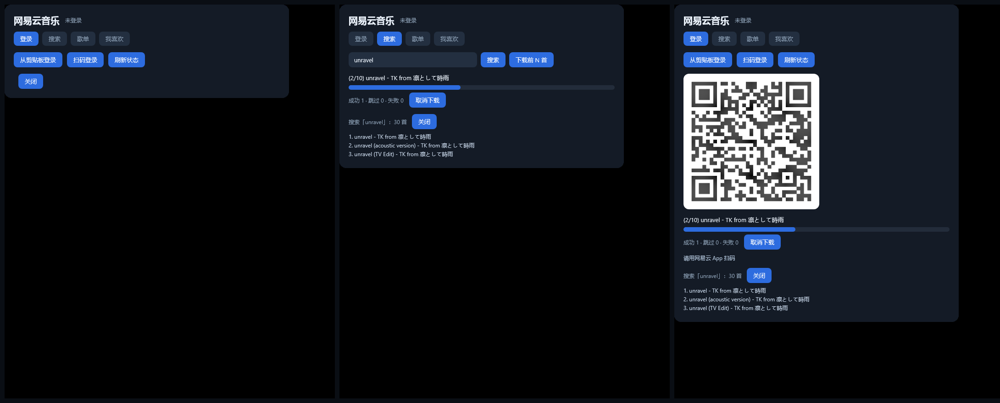

# NCM 助手 · Salt Player Mod

[](https://github.com/LeiDian-FW/salt-player-ncm-helper/actions/workflows/build.yml)
[](https://github.com/LeiDian-FW/salt-player-ncm-helper/releases)
[](LICENSE)

把网易云音乐下载的 `.ncm` 文件**自动**转成通用格式，并整理进 Salt Player 的音乐库。

> **English**: A native mod for [Salt Player for Windows](https://store.steampowered.com/app/3009140/Salt_Player/) (Steam / Microsoft Store) that automatically decrypts NetEase Cloud Music `.ncm` files into original FLAC/MP3 (bit-exact, no re-encoding), archives them as `Artist/Album`, embeds cover art, and fills in missing lyrics from NetEase.

[Salt Player](https://saltplayer.com/) 是一款本地音乐播放器，桌面版通过 [创意工坊（Workshop）](https://saltplayer.com/workshop/) 支持 Mod。本项目把此前一套 Python 工具（NCM 解密 / 归档 / 封面 / 歌词）重写为 **Java 原生插件**，不依赖 Python，在播放器进程内运行。

## 功能

| 功能 | 说明 |
| --- | --- |
| 自动识别下载目录 | 读取网易云客户端下载数据库 `webdb.dat`，并兼容常见默认目录 |
| NCM 无损解密 | 纯 JDK 实现（AES-128-ECB + RC4 keybox），输出原始 FLAC/MP3，**不重编码** |
| 自动归档 | 按 `歌手/专辑/歌手 - 歌名.ext` 写入音乐库，自动清洗非法字符 |
| 内嵌封面 | 写入 FLAC `PICTURE` 元数据块；音频帧逐字节校验，已有封面不覆盖 |
| 在线补歌词 | 播放器找不到歌词时，按歌名/歌手匹配网易云歌词（含翻译），可落盘 `.lrc` |
| **转换记录** | 保存最近的成功/跳过/失败记录，按保留天数**自动过期清理**（默认 30 天） |
| **网易云（实验）** | 扫码登录、搜索、歌单、我喜欢的音乐、下载到音乐库（默认关闭，见下方说明） |
| **原生界面** | 网易云原生 Compose 面板（需在模组管理授予 CLASS_TRANSFORM 权限） |
| 后台监视 | 定期扫描下载目录；可配置间隔 |
| 快捷键 | `Ctrl+Alt+N` 立即处理一次（需授权快捷键权限） |

### 安全设计

- **先写后删**：输出通过"音频帧逐字节比对"校验后才删除源 NCM
- SHA-1 状态记录 + 音频内容比对，重复下载不会重复入库
- 解析失败保留源文件；下载目录与音乐库重叠时自动跳过

## 环境要求

- Windows 10 / 11（Salt Player 桌面版，Steam 或 Microsoft Store 渠道均可）
- Salt Player for Windows **≥ 1.19.0**（插件 API 仍处于试验阶段，已实测 1.19.3）

## 安装

1. 从 [Releases](https://github.com/LeiDian-FW/salt-player-ncm-helper/releases) 下载最新的 `plugin-io.github.spwncm.ncmhelper-*.spmod`
2. 打开 Salt Player → **创意工坊 → 模组管理**
3. 点击 **导入模组**，选择下载的 `.spmod` 文件
4. 打开该 Mod 的操作菜单 → **启用**，按需勾选权限：
   - **快捷键** — 用于 `Ctrl+Alt+N`（不勾选不影响自动监视）
5. 需要调整参数时，在操作菜单选择 **配置**

## 配置

| 分组 | 配置项 | 默认 |
| --- | --- | --- |
| NCM 转换 | 自动监视下载目录 | 开 |
| | 音乐库目录 | `D:\music` |
| | 下载目录（可选，留空=自动识别，多个用 `;`） | 空 |
| | 扫描间隔 | 60 秒 |
| | 同时归档下载目录里的 FLAC/MP3 | 开 |
| | 转换后自动补歌词 | 开 |
| 歌词 | 在线补全歌词 | 开 |
| | 把歌词保存为 `.lrc` | 开 |
| 转换记录 | 保留天数（超期自动删除） | 30 天 |
| | 打开转换记录 / 清空转换记录 | — |

配置页还有 **立即处理一次** 与 **查看监视状态** 按钮。

## 日志与排错

日志位于：

```
%APPDATA%\Salt Player for Windows\workshop\data\io.github.spwncm.ncmhelper\ncm-helper.log
```

正常启动首行为 `启动 v1.1.0 | SPW 1.19.3 | 渠道 Steam`；每轮扫描会输出汇总。
若下载后 1 分钟仍未处理，先确认：插件已启用、下载目录与音乐库路径正确、日志中无报错。

## 已验证

在 Salt Player for Windows 1.19.3（Steam 渠道）实测：

- 宿主自动加载、解包、启用状态在升级后保留
- 向下载目录投放 NCM：60 秒内自动识别 → 转换 → 归档 → 内嵌封面 → 补歌词 → 删除源文件
- 转换速度 **< 1 秒 / 10MB**；连续运行 6 小时无内存问题
- `python run_tests.py --no-network` 在 `-Xmx512M` + `--limit-modules=java.base,java.desktop`（模拟宿主）下全部通过
- 转换记录的自测覆盖：保存 / 重新加载 / 超期自动清理 / 清空

## 网易云音乐（实验性）

Mod 配置页有独立的「网易云（实验）」分组，**默认关闭**，开启后可用：

| 功能 | 说明 |
| --- | --- |
| 扫码登录 | 在播放器内弹出二维码窗口，用网易云 App 扫码确认（Cookie 仅存插件数据目录） |
| Cookie 登录 | 扫码提示 8821/请求频繁时可改用：从浏览器复制 `MUSIC_U` 粘贴到配置页 |
| 登录状态 / 退出登录 | 查看当前账号、清除本地 Cookie |
| 下载歌单 | 填歌单 ID（如 3778678），把可下载的歌曲存到音乐库 |
| 搜索并下载 | 填关键词，下载搜索结果前 N 首 |
| 下载我喜欢的音乐 | 下载「我喜欢的音乐」前 N 首 |
| 每次最多下载 | 1–50 首（默认 10） |

注意事项：

- **仅支持可正常获取的曲目**；VIP/付费/无版权歌曲无法下载（不绕过 DRM），会记为「跳过」
- 使用网易云非官方接口，可能受其服务条款与风控策略约束；请仅用于个人合法用途
- 下载的文件会写入 `歌手/专辑/` 并尽量写入基础标签；播放器需要重新扫描音乐库才会显示
- 登录 Cookie 只保存在本机插件数据目录，不会上传；可随时「退出登录」清除
- **扫码一直提示 8821 / 请求频繁**：说明账号或网络触发网易云风控，改用 Cookie 登录：
  1. 浏览器打开 https://music.163.com 并登录
  2. F12 → Application/存储 → Cookies → `music.163.com` → 复制 `MUSIC_U` 的值
  3. 粘贴到配置页「登录 Cookie（MUSIC_U）」，点「使用 Cookie 登录」
  4. 校验通过会显示昵称；Cookie 仅保存在本机
- 若扫码后仍显示未登录，请查看日志 `ncm-helper.log`（插件数据目录）；v1.2.1 起使用进程级
  CookieManager 捕获登录 Cookie，并会在对照码 803 未拿到 Cookie 时打印诊断信息

## 原生界面（v1.3.0 起）



> 上图为使用宿主 Compose 运行时离屏渲染的真实界面截图：登录 / 搜索（含原生下载进度）/ 扫码登录。

- 配置页「网易云（实验）」→ **打开网易云原生面板**
- 首次使用需要在 **模组管理 → 权限** 中授予 **CLASS_TRANSFORM**（Hook 权限），然后重新启用模组
- 原生面板包含：**登录**（剪贴板/扫码）、**搜索**、**歌单**、**我喜欢的音乐**、**原生下载进度条（可取消）**
- 原生界面通过 Hook 宿主导航根组件 + Compose Dialog 实现，跟随宿主运行时；不可用时自动回退到配置页按钮提示

> 注：原生 UI 需要在有 Salt 安装的机器上编译（编译期对着宿主类）；CI 产物为不含原生 UI 的版本，
> 正式发布包由本机构建后上传。

## 实现要点（写给其他 Mod 开发者）

Salt Player 的 jlink 运行时**没有 `java.net.http` 模块**，JVM 堆为 **`-Xmx512M`**，
而网易云 `webdb.dat` 可达 200MB+、NCM 文件可达 60MB。因此本项目：

- HTTP 使用 `HttpURLConnection`（`java.base`），不使用 `java.net.http`
- NCM 只读取头部（密钥/元数据/封面），音频按 256 字节块流式解密并批量写出
- 封面内嵌、音频帧校验、标签读取全部基于 `RandomAccessFile` 流式处理
- 下载记录按 1MB 分块流式匹配，并缓存 5 分钟

这些约束对任何想在 SPW 上处理大文件的 Mod 都适用。

## 构建

需要 **JDK 25+**（插件 API 以 Java 25 编译）。

```bash
python get_deps.py     # 下载编译期依赖到 libs/（带 SHA-256 校验）
python build.py        # 产物 build/libs/plugin-io.github.spwncm.ncmhelper-1.1.0.spmod
python run_tests.py    # 自测：核心解密 / 歌词接口 / 完整流水线 / 打包校验
```

`JAVA_HOME` 指向 JDK 25 即可；也支持把 JDK 解压到项目下的 `jdk25/`。
构建不依赖 Gradle：`javac` + PF4J 注解处理器生成扩展索引，再按官方 `.spmod`
结构（`classes/` + `lib/`）打包。

CI（GitHub Actions）会在每次提交时构建并上传产物，打 `v*` 标签时自动创建 Release。

## 项目结构

```
src/main/java/io/github/spwncm/ncmhelper/
├── MainPlugin.java         # 插件主类：生命周期、配置、快捷键
├── NcmLyricsExtension.java # 歌词扩展点（PF4J @Extension）
├── NcmJob.java             # 下载目录识别、扫描、转换流水线、后台监视
├── NcmDecoder.java         # NCM 容器解析 + 流式 AES/RC4 解密
├── FlacCover.java          # FLAC PICTURE 内嵌与音频帧校验（流式）
├── NeteaseLyrics.java      # 网易云搜索/歌词/匹配/缓存/LRC 生成
├── Organizer.java          # 命名清洗、路径规划、标签读取、歌词跟随
├── Json.java               # 极简 JSON 解析
└── Log.java                # 文件日志
test/java/                  # 自测（自包含合成样本）
test/tools/                 # 合成 NCM/FLAC/JPEG 的测试工具
```

## 免责声明

本项目仅用于**个人已合法下载的音乐文件**的格式转换与整理，不提供任何音乐内容，
不绕过任何付费/版权机制。请勿传播转换后的受版权保护音频。
项目与网易云音乐、Salt Player 官方均无关联。

## License

[MIT](LICENSE)。第三方组件与 API 的许可声明见 LICENSE 末尾
（插件运行时依赖 ZXing core 用于生成登录二维码，Apache-2.0）。
